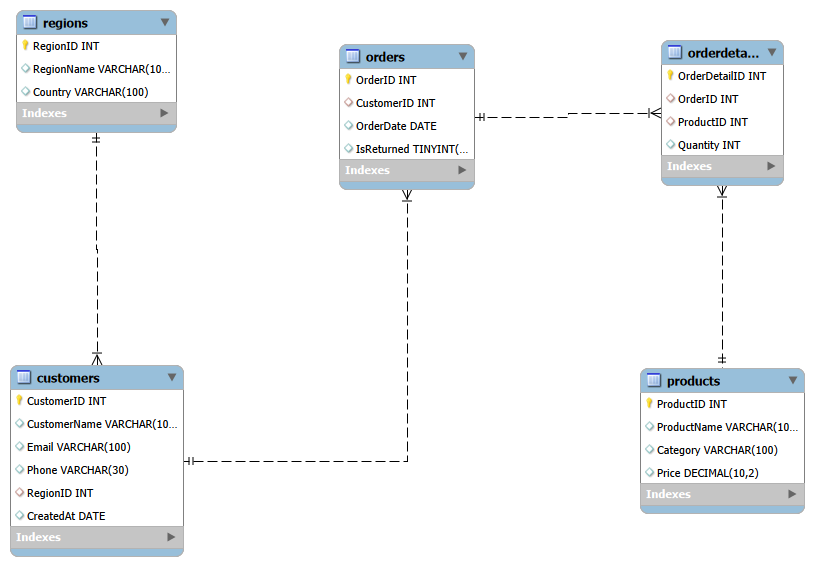

# E-Commerce Sales Analysis Using SQL

## Project Overview
This project focuses on analyzing an e-commerce business using SQL to extract meaningful business insights from sales, customer, product, regional, and return data.

The objective is to understand business performance, identify trends, and support data-driven decision-making.

## Business Analysis Areas

1. **General Sales Insights** – Analyze overall sales performance and revenue.
2. **Customer Insights** – Understand customer purchasing behavior.
3. **Product & Order Insights** – Evaluate product performance and order patterns.
4. **Temporal Trends** – Analyze sales patterns over time.
5. **Regional Insights** – Compare business performance across regions.
6. **Return & Refund Insights** – Examine returns and refund patterns.

## Tools & Technologies
- MySQL
- MySQL Workbench
- SQL

## SQL Concepts Used
- SELECT, WHERE, ORDER BY
- Aggregate Functions
- GROUP BY and HAVING
- Joins
- Subqueries
- Common Table Expressions (CTEs)
- Window Functions
- Date Functions

## Project Files

| File | Description |
|---|---|
| FINAL_PROJECT.sql | Database setup and sample data |
| General Sales Insights.sql | Sales analysis |
| Customer Insights.sql | Customer analysis |
| Product & Order Insights.sql | Product and order analysis |
| Temporal Trends,Regional Insights & Refund Insights.sql | Trend, regional, and refund analysis |
| EER DIAGRAM.mwb | Database relationship diagram |
| REFRRENCE_PNG.png |EER Diagram Preview|

## Database Schema – EER Diagram

## Future Improvements
- Build an interactive Power BI dashboard.
- Add visual representations of key business insights.
- Enhance the project with additional business KPIs.

## Author
**Rohan Shinde**

Aspiring Data Analyst | SQL | Excel | Power BI | Python

[GitHub Profile](https://github.com/Rohan252005)
